### About

I'm a backend engineer at **EY**, building services for enterprise supply-chain and dispatch planning solution platforms used by leading FMCG clients.

- Built a load-optimization service that takes forecast-driven solver jobs from **minutes to ~200 ms** response time, running **300+ times a day** in production.
- Designed token-based auth with short-lived access tokens and rotating refresh tokens stored in [PostgreSQL], adding expiry, revocation and reuse detection to secure order-management and optimization APIs.
- Re-architected licensed solver deployments to cut **recurring licence costs by ~40%**
- Sped up PySpark jobs over **2M+ daily records by ~30%** and cut deploys from **30 to 8 minutes**
- B.E. Computer Engineering (Honors in Data Science), SPPU · CGPA 9.3

Outside work: anime, and slowly getting better at 日本語.

### Stack

<!-- Also: aiohttp · asyncio · Dramatiq · Django REST Framework · PySpark · AWS Lambda / ECS / EMR -->

<!-- Add your flagship project as the first row once it's live -->

### GitHub

  <!-- 
  

 -->

### Connect

